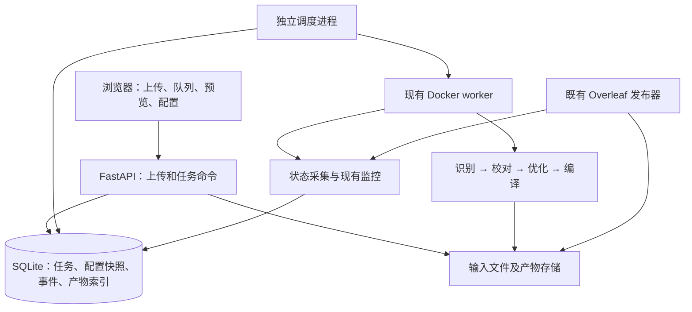

# Web 工作台功能与架构草案

日期：2026-10-08。状态：功能与架构设计；首版实现及运行方式见 [Web README](../web/README.md)。

本设计最初用于确定功能和架构，随后按用户要求启动首版实现。用户已确定网页默认识别页并发为 1，可在页面设置；网页同时只处理一个文件，多文件按队列顺序执行。用户已确定不需要登录和权限校验；所有访问者共用任务、配置和产物。推荐部署在现有 Linux 服务器，Mac 通过浏览器访问；同一套应用也支持 Mac 本地 Docker。访问地址由部署配置指定。

## 1. 推荐功能范围

| 功能 | 第一版建议 | 后续增强 |
| --- | --- | --- |
| 输入 | 单文件、多文件、文件夹递归解析全部 PDF；保留相对目录；确认清单后上传；分片续传 | 扫描指定服务器输入目录 |
| 批次 | U1/U2/U3、批次号、批次别名；同批追加文件；按批次和文件顺序排队 | 按规则自动识别批次 |
| 队列 | 开始、暂停、恢复、取消、失败重试；调整未开始任务顺序；按批次顺序组织队列 | 定时启动、优先级 |
| 进度 | 批次完成文件数、文件页数、当前阶段、页状态、运行耗时、最近更新时间 | 按相似任务估算更准确的完成时间 |
| 配置 | 各阶段模型、识别页并发、校对并发、模型服务总限额、配置模板 | 模型效果与成本对比 |
| 排错 | 失败阶段、错误摘要、脱敏日志、重启次数、下一次重试时间 | 选择页重新识别并生成新版本 |
| 产物 | 原 PDF 与编译 PDF 对照预览；下载 TeX/PDF/批次 ZIP；展示质量告警 | 页级审核、批注、版本对比 |
| TeX 编译 | 独立上传 TeX 或项目文件夹，选择主文件，XeLaTeX 编译、PDF 预览、日志下载；重新编译已有产物 | 在线编辑、更多编译引擎及文献工具链 |
| 发布 | Overleaf 发布预检、发布状态、手动触发既有发布流程 | 大文件拆分预览与发布方案 |
| 运维 | 容器状态、磁盘余量、监控更新时间、邮件通知状态、日报与费用统计 | 带保留规则的缓存清理 |
| 追溯 | 记录来源、哈希、模型与配置、运行尝试、产物版本；按批次关联 U1/U2/U3 | 向 data/traceability 输出合并追溯材料 |

第一版中的优先交付顺序：上传与持久队列 → 配置和进度 → 恢复与排错 → 预览、统计和发布。每一步都属于完整方案，避免一次上线所有界面。

文件夹上传的具体行为：

1. 在浏览器选择文件夹，递归枚举其所有子目录，筛选扩展名为 `.pdf` 的文件（大小写不敏感）。非 PDF 文件不上传；压缩包不自动解压。
2. 上传前展示完整 PDF 清单，包含文件名、相对路径、文件大小、PDF 数量和总大小；同名 PDF 用相对路径区分。用户可取消勾选文件并调整顺序。
3. 默认按相对路径自然排序（数字按数值排序），明确显示最终队列顺序。没有 PDF 时显示空状态，不创建任务。
4. 确认清单后仅上传选中的 PDF，服务端再校验文件内容；每个 PDF 对应独立文件任务，按清单顺序串行处理。上传失败或校验失败的条目标明原因，不能静默跳过或打乱后续顺序。

文件夹上传依赖浏览器目录选择能力，不支持时使用多文件上传。选择本地目录意味着枚举并上传 PDF 内容，不是让服务器直接访问 Mac 路径。

## 2. 页面结构与操作流程

导航建议为：概览、上传与队列、TeX 编译、批次与产物、配置、运行记录。

- **概览**：当前文件、排队/失败数量，当前文件阶段进度，今日页数与费用，磁盘空间，异常与监控状态。
- **上传与队列**：选择文件或文件夹 → 递归解析并展示 PDF 清单 → 勾选文件、检查重名/重复文件及顺序 → 选择 U 单元和批次 → 选择模型模板和页并发 → 确认上传并提交。上传中的文件不能进入执行队列。
- **任务详情**：源 PDF 与编译 PDF 双栏；阶段条、源页状态、日志、配置快照、重试历史、产物和发布状态。输出页可能多于源页，使用已有源页标记辅助定位，不假设页码一一对应。
- **批次与产物**：按批次号检索，显示 U1/U2/U3 来源、别名、完成情况、审核状态、下载及 Overleaf 发布结果。
- **配置**：模型服务与阶段模型、并发、目录、通知、发布、保留规则。保存模板只影响后续任务。

无账号体系，因此不引入用户角色或任务隔离。操作记录保留时间、操作内容与请求标识，不声称能够识别实际操作者。

### 视觉规范

采用简洁、低装饰的工具界面。用户指定的基础风格如下；accent 色暂建议蓝色 `#2563EB`，作为可替换的统一设计变量。

| 元素 | 规范 |
| --- | --- |
| 背景 | 浅色 `#F7F7F5`；深色模式 `#111111` |
| 卡片 | 浅色模式白色；深色模式建议 `#191919` |
| 边框 | 1px 极淡边框，浅色建议 `#E8E8E4`，深色建议 `#292929` |
| 主色 | 单一 accent，用于主按钮、选中项、链接和进度；避免多色渐变 |
| 圆角 | 6–10px，卡片与输入框统一采用 8px |
| 阴影 | 默认无阴影；仅弹层和浮动菜单使用少量阴影 |
| 正文字体 | 优先 Inter，备选 Geist / IBM Plex Sans，中文回退系统无衬线字体 |
| 代码字体 | JetBrains Mono，用于 TeX、日志和模型标识 |

错误和警告允许使用少量语义色，同时提供图标与文字，不能只靠颜色表达状态。淡边框仅用于区域分隔，输入框聚焦态和键盘焦点使用清楚可见的 accent 描边。正文保持足够对比度。

### 任务详情优先回答的五个问题

| 用户问题 | 直接展示的信息 | 下一步操作 |
| --- | --- | --- |
| 现在处理到哪了？ | 当前文件、队列位置、当前阶段、已完成/总源页数、正在处理的页集合、耗时和更新时间 | 查看页列表、暂停队列 |
| 哪个页面失败了？ | 失败页码、所在阶段、简明原因、尝试次数、是否等待重试 | 筛选失败页、定位原 PDF、展开对应日志；首版按文件恢复，页级重跑后续提供 |
| 用了哪个模型？ | 阶段配置模型，以及每次调用实际供应商/模型；回退时显示原模型与回退模型 | 展开本页调用记录和任务配置 |
| 花了多少 Token？ | 当前文件输入/输出 Token、供应商返回的缓存 Token 明细、调用数及重试消耗 | 按阶段或页面展开，查看估算费用 |
| 生成的 TeX 有没有问题？ | 编译结果、结构检查、缺失字符、括号/数学环境、溢出或裁切等检查项及证据 | 定位 TeX 行号/源页、查看编译 PDF 和日志、下载产物 |

详情页顶部放文件名、队列位置和操作按钮；其下是阶段进度与简短指标（页数、实际模型、Token、检查状态）。主区域使用“页面列表 + 预览”，详情标签为“页面 / TeX / 检查结果 / 调用记录”。完整日志放在展开区域，避免第一屏全是技术输出。

页列表列出源页码、阶段状态、实际模型、Token、耗时和问题摘要，支持“全部 / 处理中 / 失败 / 有告警”筛选。文件级优化或编译错误无法定位到源页时明确标为文件级，不虚构失败页码；无法归属到单页的 Token 同样留在阶段或文件汇总中。

模型标识以调用记录为准，记录请求模型与服务返回模型；供应商未返回实际模型时注明“请求模型”。Token 缺失时显示“未返回”，不当作 0；缓存 Token 依供应商口径注明是否已计入输入量，不能重复相加。重试调用计入实际总消耗，复用已有转换缓存不计为新调用。

检查项使用“通过 / 告警 / 失败 / 未检查 / 检查中”，并绑定产物版本。编译通过只证明该项通过，不代表内容、数学符号或版面全部正确。重点包含已关注的科学计数法、`≥`/`≤`、`μL`/`uL`、括号和数学环境闭合；沿用现有检查能力，缺少自动检测的项显示“未检查”，允许通过 PDF 对照复核。

### 供应商、模型与 API Key

配置流程为“选择供应商 → 选择模型 → 输入 API Key → 验证并保存”。供应商决定服务地址和可用模型，模型清单来自配置或服务实际支持的查询接口；允许手动填写模型 ID。首版仅开放现有调用链支持的协议，不能仅凭供应商名称声称兼容所有 API。

普通配置先展示识别模型和页并发（默认 1）；高级配置展开回退、校对、优化和修复模型，每个阶段均可指定供应商及模型。任务详情持续展示启动时配置和实际调用，不受之后更改默认供应商影响。

API Key 使用密码输入框，可在输入期间切换显示。保存后清空输入框，只显示“已配置”，提供替换和删除入口，不回传原始 Key。后端将 Key 写入 Git 外权限为 `0600` 的凭据文件；配置和任务仅保存带版本的凭据引用，替换 Key 不静默更改运行任务的引用。删除仍被运行任务引用的凭据时提示正在使用并阻止删除。

Key 不写入浏览器持久存储、日志、任务事件、配置导出或下载 ZIP。连接验证区分凭据错误、模型不可用、超时和限流；需要真实模型调用才能验证时，按钮明确标注“测试调用（可能消耗 Token）”，并记录这次调用。模型列表查询成功不等于该模型支持图像识别，能力验证结果单独展示。

### 独立 TeX 编译

提供独立“TeX 编译”入口，与 PDF 转换入口分开：

1. 上传单个 `.tex`，或选择包含 `.tex`、图片、`.sty`、`.cls` 等依赖的项目文件夹，保留相对目录。此入口列出项目文件，不采用 PDF 上传入口的“仅筛选 PDF”规则。
2. 展示主文件候选；只有一个含 `\documentclass` 的文件时默认选中，存在多个候选时由用户选择。单文件缺少图片或引用文件时，明确提示缺失路径。
3. 点击编译后进入持久队列，默认使用已有运行镜像中的 XeLaTeX，执行两轮编译以解析交叉引用；界面显示排队、编译轮次、耗时与结果。与 PDF 转换共用全局单任务执行槽，不额外开启并行任务。
4. 成功后直接预览 PDF，可下载 PDF、源文件和编译日志；失败显示首个关键错误、文件名与可用行号，并保留完整日志。告警展示缺失字符、未解析引用及版面溢出等；编译通过不表示全部质量检查通过。
5. 转换任务的 TeX 产物提供“重新编译”操作，创建独立编译任务并引用确定的产物版本，不重新识别 PDF，也不覆盖原始产物或自动发布到 Overleaf。

编译结果可直接点击打开：任务列表、批次产物列表和 TeX 编译列表中的已编译文件名，以及“查看 PDF”按钮，均跳转到该文件的 PDF 预览页。预览页展示文件名、编译时间和产物版本，提供翻页、页码跳转、缩放、下载 PDF 以及返回列表；从列表进入时保留原来的筛选和滚动位置。

预览使用稳定的产物 ID 路由（建议 `/artifacts/<artifact_id>/preview`），刷新或直接访问链接仍可加载同一版本，不依赖浏览器临时上传对象。文件级入口默认打开最新一次成功编译的 PDF；具体编译记录中的入口固定打开该次结果。若最近一次编译失败而存在旧 PDF，明确标注“上次成功版本”和最新失败状态，不将旧结果显示为本次成功。尚未生成 PDF 时显示编译进度或错误原因，不出现无效跳转。产物不存在时显示明确提示并提供返回入口。

纯编译不调用模型，不要求供应商或 API Key，不产生模型 Token 消耗；自动 AI 修复不隐含在编译按钮中。第一版不承诺支持 BibTeX/Biber、需要 shell escape 的宏包或所有第三方模板；缺少宏包、字体或外部工具时显示具体依赖问题，后续按实际需要扩展。

任务增加 `kind=pdf_convert|tex_compile`，编译任务保存主文件相对路径、项目内容哈希、编译引擎和运行镜像版本。上传校验按任务类型区分，项目中 PDF 图片作为依赖保存，不变成 PDF 转换任务。每次编译使用独立输出目录，检查结果关联本次产物；失败时不能把旧 PDF 当作本次成功结果。

编译在独立容器内运行：禁用 shell escape，无网络，不挂载模型凭据及宿主机业务目录，仅挂载本次项目和输出目录；设置 CPU、内存、进程数和超时上限。执行参数由后端生成，不接受任意 shell 命令。这些约束用于保证上传项目的编译不会干扰现有任务。

## 3. 架构建议

推荐 **React + TypeScript + Vite 前端，FastAPI 接口，SQLite 持久任务库，独立 Python 调度进程，现有 Docker worker**。前端构建文件由服务端提供，浏览器与 API 同源。首版不引入 Redis、Celery 或多节点调度。



接口进程负责接收命令和查询，不在 HTTP 请求或页面线程中运行转换。关闭浏览器不改变任务状态，API 重启也不终止 worker。调度进程管理任务领取、执行尝试、容器生命周期和恢复；流水线继续负责转换、缓存与阶段校验。

选择独立前端是为了目录上传、持久队列和 PDF 对照界面的交互；现有 Streamlit 页面可暂时保留为旧入口，不作为新任务系统的状态来源。

### 模块边界

1. **上传存储**：创建上传会话、接收分片、校验哈希与 PDF、完成入库。只返回文件 ID，不允许浏览器提供任意服务器路径。
2. **任务服务**：提交批次、调整顺序、暂停/恢复/取消、创建重试；统一检查状态转换与幂等性。前端不能直接修改状态字段。
3. **执行与恢复**：领取任务、分配容器、应用配置快照、观察退出、恢复中断。复用 `BatchConfig` 和 `run_batch`，避免另写转换链路。
4. **状态与产物查询**：汇总页进度、日志、监控、统计及产物索引；保留原始数据来源和更新时间。

模块先放在同一个 Python 应用内；仅 API、调度器、worker 需要独立进程，不把每个模块拆成服务。Docker 控制能力只给调度器，API 不接收 shell 命令或任意镜像名称。

## 4. 队列与运行语义

### 页并发可配置，文件串行执行

- **识别页并发**：一份 PDF 同时识别的页数，网页默认 **1**，可在提交页面设置并保存为配置模板；当前 `BatchConfig` 的代码默认值为 4，不能直接继承。此前 CLI 队列的 3 页设置不作为网页默认值。
- **文件并发**：当前 Web 全局固定为 **1**，不提供多文件同时执行的开关。多文件、文件夹以及多个浏览器提交的任务进入同一个持久队列，依次处理。调度器必须保证最多一个活动文件，不能只靠页面禁用按钮。
- **模型服务总限额**：对同一文件内的识别、回退、校对和优化请求设置服务预算，避免提高页并发后超出服务限额。若与历史 CLI 任务共用模型服务，应在部署配置中划分额度。

校对页并发作为独立高级设置。页面主要显示一个当前文件的源页进度和阶段进度，其他文件按已完成、排队、失败展示。页并发修改默认对下一份未启动文件生效；当前文件保留启动时的值，界面明确显示生效范围。若以后支持运行中调整，需先实现可靠的流水线控制点。

配置快照记录：各阶段模型和服务引用、并发、DPI、超时、提示词/流水线版本、输出规则。凭据只记录服务引用，不将密钥复制进快照。修改默认值不改变已提交任务；在页面修改某个未启动任务的页并发会记录新的配置版本；改变运行任务的模型需暂停并创建新的执行版本，按依赖失效后续缓存。恢复原配置的任务继续复用缓存。

### 状态与停止

上传状态与任务状态分开；文件校验完成后才创建可运行任务。

```text
queued → starting → running → succeeded
                      ├→ pause_requested → paused → queued
                      ├→ retry_wait → queued
                      ├→ failed → queued（显式重试）
                      └→ cancel_requested → cancelled
```

每次执行单独记录 attempt，不覆盖历史失败；自动重启计数与手动重试记录分开。`succeeded` 只表示转换和产物校验完成。审核、Overleaf 发布各有独立状态，发布失败不重新识别。

- 暂停队列：停止领取下一份 PDF，让当前文件完成；界面明确显示“当前文件完成后暂停”。
- 暂停当前文件：需要新增流水线控制点；停止发起新请求，让在途请求完成并保存后进入 paused。未完成此能力前，不显示可用按钮或声称支持页级暂停。
- 取消：停止后续工作，正常终止在途进程；保留输入与缓存，取消不等于删除。
- 崩溃恢复：先核对容器、进程和持久阶段状态，再决定接管或重试，不能仅因心跳延迟重复启动。
- 同一队列失败后默认停在该文件，后续保持排队；允许用户显式选择跳过。

临时 API 错误沿用 3、6、12、24、48、96 分钟的自动重启策略，每份 PDF 最多 6 次；认证错误、OOM、编译错误显示为需要处理。每次重启前以及结果确定后发送现有要求的邮件，失败写明第几次；通知结果也写入运行记录。

任务领取采用 SQLite 事务和唯一活动尝试约束，容器名包含 job ID 与 attempt ID。启动前先保存 starting 记录，崩溃后按该名称核对实际容器；写产物时检查当前 attempt，防止旧进程覆盖新结果。控制命令带版本号，多个浏览器同时操作时返回冲突并刷新。

## 5. 文件、批次与数据库

一个批次关联多个来源文件；同一批次可含 U1/U2/U3。一个来源文件可有多个配置版本任务，一个任务可有多次执行尝试。建议表：`batches`、`batch_aliases`、`uploads`、`documents`、`jobs`、`attempts`、`events`、`artifacts`、`publications`、`config_versions`。

输入去重以内容 SHA256 为依据，原始文件名、相对目录和单元独立保留。相同文件跨批次可以关联复用输入，但是否复用转换结果还必须检查配置和流水线版本；同名不同内容生成新文件版本，不能覆盖。

建议新增数据布局（根目录全部可配置）：

```text
data/web/state.sqlite3
data/web/uploads/<upload_id>/
data/web/config.json
data/workers/web/<job_id>/       # 稳定工作目录，重试沿用缓存
data/optimized/...              # 延续现有正式产物目录
data/traceability/<batch>/      # 后续追溯导出
```

内部 job ID 避免跨批次同名 PDF 共用缓存；重试日志按 attempt 分开。正式目录发生同名产物冲突时保留版本并报告，不自动覆盖。批次别名如 `A33Z202410007` 映射到 `A33Z2202410007`，保留原路径和改名记录，不直接移动历史数据。

任务库保存调度状态；每个 worker 的 `.state/pipeline.sqlite3` 继续保存阶段与缓存状态。任务库不直接改阶段库，采集器可从阶段事实重建展示数据。使用 SQLite WAL 和短事务，数据库放服务器本地磁盘；规模超过单机再考虑 PostgreSQL。

## 6. 上传、进度与资源管理

上传会话记录分片、总大小、哈希和有效期；相同分片重复提交保持幂等，最终校验成功后原子入库。清理超时残片不影响已完成输入。校验相对路径，拒绝 `..`、绝对路径和重复目标路径；PDF 无法读取、加密或不支持时在入队前显示原因。

进度由源页完成集合和阶段状态计算，不采用“最大已完成页码”：并发时第 10 页完成并不代表前 9 页全部完成。显示识别 `18/30`、校对 `7/30`、优化状态、编译轮次，上传百分比独立展示。没有可量化进度的阶段显示状态与耗时，不编造百分比。

首版使用每 2–5 秒增量轮询和事件游标，后台聚合进度，避免每个浏览器反复扫描全部日志。采集周期单独配置；现有两分钟监控快照用于健康状态，不承担页级实时进度。后续需要更即时再加 SSE。

ETA 使用近期实际耗时与有效并发估算，区分识别单页耗时和流水线吞吐；样本不足显示“估算中”。成本按实际调用统计，未知价格显示未知，重试费用计入，避免把缓存命中算作新调用。

上传前检查磁盘并预留执行空间，空间阈值、单文件/整批大小、临时文件保留期写入配置。空间不足时拒绝新上传或暂停领取任务，并显示原因。默认不自动删除原件、最终产物和恢复所需缓存。

## 7. 配置、发布和既有任务接入

版本管理的 `deploy/web.example.json` 保存模板，实际配置存于 Git 外的数据目录。配置覆盖关系为：模板默认值 → 部署配置 → 提交时选项，最终解析成任务快照；未启动任务可显式修改设置并产生新的配置版本，启动后快照不可变。路径、队列顺序、服务限额、通知、Overleaf 目标都来自配置；Web 写入配置需校验并原子保存。

服务配置包含供应商、名称、Base URL、可用模型、超时和凭据引用。支持在网页输入 Key，由后端保存至服务器保护文件，也兼容部署环境注入；保存后前端只看到已配置状态，日志和配置导出均脱敏。不通过修改公共 `.env` 为不同任务切换模型；每个 worker 使用独立环境。

Overleaf 沿用既有发布器：先拉取最新内容，仅增加缺失文件；同名同内容跳过，同名不同内容停止并报告。U1/U3 各自项目目标均为 `待审核/<批次号>`；U2 不因新 Web 自动启用发布。自动发布策略沿用部署配置，网页触发和 timer 共享锁及发布账本。删除/替换远端文件、大文件拆分后的原件删除属于单独操作，不能作为普通重试的副作用。

先把历史 CLI 队列和产物以只读方式导入 Web，标识为外部管理。Web 新任务由新调度器管理。转移某一队列的控制权时，需停用它在旧 `queue_dispatch.py` 中的条目并核对活动容器，再登记唯一调度归属。

同样明确重启归属：旧监控继续管理旧容器；Web 管理的容器由 Web 调度器重启，旧监控只观察并复用告警能力。避免两套系统同时重启。日报继续使用服务器账本，Web 只查询，不创建第二份完成统计来源。

## 8. 实现依据与待补能力

| 当前代码 | 可复用内容 | 必须补充或调整 |
| --- | --- | --- |
| `pipeline/app.py` | 已有上传、预览相关交互参考 | 队列依赖 `st.session_state` 和线程，不能承担持久调度；上传按原名落盘需要替换 |
| `pipeline/texopt/runtime/stages.py` | `BatchConfig`、`run_batch`、阶段校验及缓存 | 显式任务配置、控制点、结构化进度、attempt 约束 |
| `scripts/run-sequential-queue.py` | 顺序执行、状态文件、监控登记 | 当前目录为 `/data/workers/<stem>`，需支持显式任务工作目录 |
| `scripts/queue_dispatch.py` | 批次顺序和异常阻塞原则 | 与 Web 划分唯一调度归属 |
| `pipeline/texopt/monitoring/` | 运行状态、日报和费用 | 建立只读汇总接口、去重告警及重启归属 |
| `scripts/overleaf_publish.py` | 拉取后增量发布 | 共享发布锁、向 Web 输出结构化状态 |

## 9. 分阶段验收

1. **持久任务基础**：同批追加、多文件/目录上传；多层目录中的 `.pdf` 和 `.PDF` 均列入清单，非 PDF 不上传，空目录不创建任务，同名文件保留相对路径，执行顺序与确认清单一致；1 页默认并发且页面可调整；全局最多一个活动文件；同名异内容不覆盖；刷新/关闭浏览器任务继续；重复提交不会创建重复任务；目录穿越被拒绝。
2. **配置与资源约束**：前后两个任务可使用不同模型和页并发；多个浏览器提交仍然串行执行；修改默认配置不影响已有任务；服务总额度有效；磁盘不足不继续接收任务。
3. **恢复与可观测性**：API/调度器意外重启不会重复启动容器；暂停与取消状态真实；缓存恢复有效；乱序完成页正确计数；重启前后通知包含结果和次数。
4. **结果与接入**：PDF 对照、TeX/PDF 下载、编译告警、历史批次查询；发布前拉取，同名冲突不覆盖；旧调度器和监控不会重复执行 Web 任务。
5. **界面与模型可观测性**：浅色/深色均遵循统一视觉变量；供应商、模型及 Key 可配置且不泄漏凭据；失败页可定位；回退模型正确展示；Token 缺失不显示为 0、重试不漏计、缓存明细不重复累计；文件级错误不虚构页码；未检查项目不标为通过。
6. **独立编译**：单 TeX、含图片和自定义样式的项目均可选择主文件编译；缺失依赖和语法错误可定位；两轮编译可解析常规交叉引用；点击文件可进入对应版本的 PDF 预览页，刷新直达有效、返回保留列表状态；不配置模型 Key 也可运行且不产生模型调用；与转换任务串行；失败不展示旧 PDF 为新结果；超时可终止且不会访问其他任务目录。

首版已有独立 Web 服务和执行器；具体已实现功能、模型兼容范围及验证方式见 Web README。所有 Web 工作数据放在 `data/web/`，避免与原队列目录混用；原 CLI、Compose 和生产配置不改动。技术栈和分期是建议；明确的用户约束为无权限校验、网页默认 1 页并发且可设置、网页全局单文件串行执行、批次顺序、配置文件管理，以及既有发布和通知规则。
